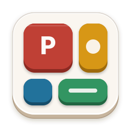

<p align="center">
  
</p>

<h1 align="center">Primary Theme for Google Antigravity 2.0</h1>

<p align="center">
  <strong>Comfy, playful, tactile Bauhaus & IKEA wooden-toy inspired theme for Google Antigravity 2.0</strong><br/>
  <em>An unofficial community port of <a href="https://github.com/primary-theme/obsidian">Primary for Obsidian</a> by <a href="https://github.com/ceciliamay">Cecilia May</a></em>
</p>

<p align="center">
  <a href="./LICENSE"></a>
  <a href="https://github.com/primary-theme/obsidian"></a>
  <a href="https://ko-fi.com/ceciliamay"></a>
</p>

---

## ✨ Overview

**Primary Theme for Antigravity 2.0** brings the signature warmth, Bauhaus primary accents, and 3D tactile keycap physics of **Cecilia May's** award-winning [Primary for Obsidian](https://github.com/primary-theme/obsidian) to **Google Antigravity 2.0**:

- 🎨 **Dual Warm Nostalgia Palettes**:
  - **Light Mode**: Aged magazine cream (`#FAF6F0`), warm oatmeal sidebar (`#EEE7DD`), espresso ink (`#432E14`), and **Bauhaus Red (`#BF3F36`)** primary accent.
  - **Dark Mode**: Warm cocoa walnut (`#211B16`), deep espresso sidebar (`#1C1712`), parchment ink (`#D7C0A3`), and **Bauhaus Yellow (`#F4B943`)** primary accent.
- 🖍️ **Semantic Bauhaus Markdown Typography**:
  - **Bold (`strong`)** in Bauhaus Red, *Italics (`em`)* in Bauhaus Blue, and [Links](https://primary-theme.github.io/) in Bauhaus Yellow with warm wavy underlines.
- 🧸 **3D Tactile Toy Keycap Physics**:
  - Multi-layered specular top highlights, 1px warm contours, and recessed bottom lips on buttons, round composer action pills, cards, `<kbd>` keycaps, and recessed toggle switch grooves.
  - Borderless 3D keycap elevation on keyboard `:focus-visible` navigation (zero container clipping).
- 🌈 **6-Color Bauhaus Rainbow Sidebar**:
  - Automatic 6-color cycle (Red → Orange → Yellow → Green → Blue → Purple) across project folders and conversation list indicators with seamless alpha-masked hover actions.
- 💻 **Unified Code Blocks & 19 Prism Syntax Tokens**:
  - Clean single-layer code cards with oatmeal language headers and complete `--syntax-*` token mapping for Light & Dark modes.

---

## 📦 Installation

### Option 1: Install as an Antigravity 2.0 Plugin (Recommended)

Clone this repository directly into your global Antigravity plugins directory:

```bash
mkdir -p ~/.gemini/config/plugins
git clone https://github.com/<your-username>/primary-theme-antigravity.git ~/.gemini/config/plugins/primary-theme
```

Once installed:
1. Restart Antigravity 2.0 (or enable **Primary Theme for Antigravity** under **Customizations → Plugins**).
2. The bundled `SessionStart` hook (`hooks.json`) automatically injects the theme whenever a session starts.
3. You can also ask the agent in chat at any time:
   - *"Apply Primary Theme to my current Antigravity 2.0 window"*
   - *"Enable Primary Theme automatic background injection on app launch"*
   - *"Remove Primary Theme"*

---

### Option 2: Standalone CLI / Live Hot-Reload

```bash
# 1. Immediately inject Primary Theme into all running Antigravity 2.0 windows:
node ./primary-cli.mjs apply

# 2. (Optional) Watch src/*.css and hot-reload changes in <50ms:
node ./primary-cli.mjs watch

# 3. (Optional) Install macOS LaunchAgent to auto-inject on every app launch:
node ./primary-cli.mjs autostart

# 4. Copy self-contained snippet to macOS clipboard (for DevTools Console Cmd+V):
node ./primary-cli.mjs copy

# 5. Remove theme & restore default Antigravity appearance:
node ./primary-cli.mjs remove
```

---

## 🗂️ Architecture

```text
primary-theme/
├── plugin.json                      # Antigravity 2.0 Plugin manifest
├── hooks.json                       # SessionStart hook for automatic theme injection
├── assets/
│   └── logo.svg                     # 3D Bauhaus toy block plugin icon
├── scripts/
│   └── session-start-hook.mjs       # Hook runner (complies with Antigravity JSON stdout contract)
├── skills/
│   └── primary-theme/
│       └── SKILL.md                 # Agent skill for managing & customizing the theme via chat
├── src/
│   ├── 01-palettes.css              # Light/Dark palettes & Onyx surface variable mappings
│   ├── 02-typography-markdown.css   # Headings, bold/italic/link colors, lists & blockquotes
│   ├── 03-tactile-components.css    # 3D buttons, composer, switches & borderless focus lift
│   ├── 04-code-syntax.css           # Fenced code cards, inline code, <kbd> & Prism tokens
│   ├── 05-callouts-tables.css       # Callout alerts & markdown tables
│   └── 06-sidebar-animations.css    # 6-color rainbow sidebar & popup spring animations
├── dist/
│   ├── primary-antigravity.css      # Compiled single-file stylesheet
│   ├── devtools-inject.js           # Self-contained console injection script
│   └── theme-seeds.json             # Theme seed metadata
├── build.mjs                        # Zero-dependency CSS bundler
├── primary-cli.mjs                  # Live CDP injector, watcher & LaunchAgent CLI
├── patch-app.mjs                    # Optional static app.asar patcher with backup/restore
└── LICENSE                          # GNU General Public License v3.0 (GPL-3.0)
```

---

## 🩵 Credits & License

- **Original Theme Creator**: [**Cecilia May**](https://github.com/ceciliamay) — Author and designer of [**Primary for Obsidian**](https://github.com/primary-theme/obsidian) ([Website](https://primary-theme.github.io/) · [Support Cecilia May on Ko-fi](https://ko-fi.com/ceciliamay)).
- **Disclaimer**: This project is an **unofficial community port** created for **Google Antigravity 2.0**. Please do **not** report Antigravity-specific layout issues to the upstream Obsidian repository.
- **License**: Distributed under the [**GNU General Public License v3.0 (GPL-3.0)**](./LICENSE), in full compliance with upstream licensing terms.
